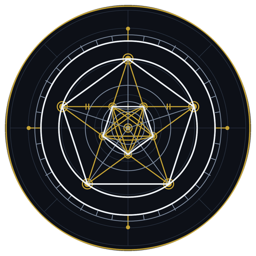

GEOMETOR • divine
=================

**Visit the Online Archive:** https://geometor.github.io/divine/

.. image:: docsrc/_static/root3-harmonics.png
   :alt: GEOMETOR • divine featured geometric construction
   :target: https://geometor.github.io/divine/
   :align: center

**Divine Proportion • Golden Ratio Discovery Engine & Constructions • semantic digital archive**

Mission
-------

``geometor/divine`` is part of the interconnected `GEOMETOR <https://geometor.com>`_ semantic digital archive. It provides an automated symbolic discovery engine and exhaustive catalog of golden sections, golden chains, and proportional invariants over :math:`\mathbb{Q}(\sqrt{5})` and radical extensions. By translating classical Euclidean problems, Cut-the-Knot investigations, and modern journal demonstrations into certified SymPy dependency graphs and calibrated vector diagrams, the archive establishes an exact algebraic baseline for golden ratio geometries across the GEOMETOR corpus.

Catalogs in This Archive
------------------------

- `Catalog of Golden Ratio Constructions <https://geometor.github.io/divine/constructions/>`_ — 45 machine-certified golden ratio constructions across seven geometric families in exact symbolic algebra.

Python Package & Modules
------------------------

The ``geometor-divine`` Python package (``import geometor.divine``) provides the executable symbolic geometry, construction, and compilation modules powering this archive:

- ``catalog/registry.py`` — Master registry of the 7 geometric families and 45 cataloged constructions.
- ``divine.py`` — Main entry point for the divine analysis module.
- ``events.py`` — Event listeners for divine analysis.
- ``golden/chains.py`` — Golden Chain Analyzer: Harmonic Range Identification in Golden Sections.
- ``golden/groups.py`` — Module for grouping and organizing Golden Sections.
- ``golden/ranges.py`` — Analysis of harmonic ranges in geometric lines.
- ``catalog/apparatus.py`` — Scholarly apparatus registries for the Catalog of Golden Ratio Constructions.
- ``catalog/circles_sangaku.py`` — Family 06: Circles, Tangent Packings, Yin-Yang & Sangaku Configurations.
- ``catalog/equilateral_hexagon.py`` — Family 02: Equilateral Triangles & Regular Hexagons — The Odom Lineage.
- ``catalog/generate_codex.py`` — Deterministic generator for the Golden Ratio Catalog Book Codex & JSON resources.
- *Plus 8 additional modules under* ``src/geometor/divine/``.

See the `API Reference <https://geometor.github.io/divine/modules/>`_ for full module documentation.

Repository Contents
-------------------

- ``docsrc/`` — RST catalog tracks, guides, and comparative tables compiled by `PHOTON publish <https://github.com/photon-platform/publish>`_.
- ``resources/`` — Construction registries, manifests, and serialized model artifacts.
- ``src/geometor/divine/`` — Golden section discovery engine, chain scanner, and catalog definition library.

Local Build & Verification
--------------------------

.. code-block:: bash

   publish build
   uv run --no-sync pytest

Part of the GEOMETOR Knowledge Archive
--------------------------------------

Explore all **74 Book Codices** and **11 Mathematical Catalogs** at https://geometor.com/books/.
