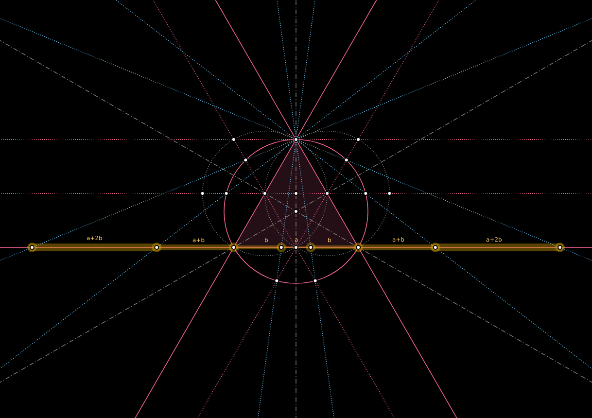

GEOMETOR • divine
=================

**Visit the Online Archive:** https://geometor.github.io/divine/

**Divine Proportion • Golden Ratio Discovery Engine & Constructions • semantic digital archive**

Mission
-------

``geometor/divine`` is part of the interconnected `GEOMETOR <https://geometor.com>`_ semantic digital archive. It provides an automated symbolic discovery engine and exhaustive catalog of golden sections, golden chains, and proportional invariants over :math:`\mathbb{Q}(\sqrt{5})` and radical extensions. By translating classical Euclidean problems, Cut-the-Knot investigations, and modern journal demonstrations into certified SymPy dependency graphs and calibrated vector diagrams, the archive establishes an exact algebraic baseline for golden ratio geometries across the GEOMETOR corpus.

Catalogs in This Archive
------------------------

- **`Catalog of Golden Ratio Constructions <https://geometor.github.io/divine/constructions/>`_** — 45 machine-certified golden ratio constructions across seven geometric families in exact symbolic algebra.

Repository Contents
-------------------

- ``docsrc/`` — RST catalog tracks, guides, and comparative tables compiled by `PHOTON publish <https://github.com/photon-platform/publish>`_.
- ``resources/`` — Construction registries, manifests, and serialized model artifacts.
- ``src/geometor/divine/`` — Golden section discovery engine, chain scanner, and catalog definition library.

Local Build & Verification
--------------------------

.. code-block:: bash

   publish build
   uv run --no-sync pytest

Part of the GEOMETOR Knowledge Archive
--------------------------------------

Explore all **74 Book Codices** and **11 Mathematical Catalogs** at https://geometor.com/books/.
