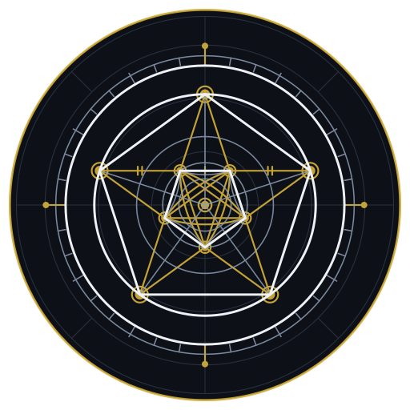

:site_title: Divine Proportion Discovery

.. container:: author-overline

   semantic digital archive • mathematical catalog

===========================
Divine Proportion Discovery
===========================

**geometor.divine** is an automated symbolic discovery engine that scans exact geometric constructions to uncover hidden golden sections (:math:`\phi = \frac{1+\sqrt{5}}{2}`), harmonic ranges, and multi-point proportional chains. Alongside its Python analysis toolkit, this archive curates a machine-certified catalog of forty-five ruler-and-compass constructions spanning Euclid, Ptolemy, Kepler, and modern *Cut-the-Knot* geometers—all built in 100% exact SymPy algebra over :math:`\mathbb{Q}(\sqrt{5})` and its radical extensions.

Catalog & Discovery Engine
--------------------------

.. container:: home-book-hero

   .. container:: home-book-thumb

      .. image:: constructions/05-pentagons-polygons/01-ptolemy-pentagon-pentagram/01-ptolemy-pentagon-pentagram.svg
         :alt: Claudius Ptolemy's Regular Pentagon and Pentagram Golden Ratio Construction
         :target: constructions/index.html

   .. container:: home-book-body

      .. rubric:: Mathematical Catalog · 7 Geometric Families · 45 Constructions

      **Catalog of Golden Ratio Constructions** — Forty-five certified constructions organized across seven geometric families—from Euclid II.11 and minimal five-step compass divisions to equilateral hexagons, *sangaku* circle packings, and Ptolemy's pentagon—certifying **129 exact golden sections** and **33 connected golden chains**.

      .. container:: home-actions

         * :doc:`Browse the Catalog → <constructions/index>`
         * :doc:`Start at Euclid II.11 → <constructions/01-minimal-compass/01-euclid-ii-11/index>`
         * :doc:`Master Comparative Table → <constructions/comparative_table>`

.. container:: home-book-hero

   .. container:: home-book-thumb

      .. image:: _static/root3-harmonics.png
         :alt: Root-3 Harmonics and Collinear Golden Chains in GEOMETOR
         :target: usage/index.html

   .. container:: home-book-body

      .. rubric:: Symbolic Analysis Engine · Python API & Synthesis Guides

      **Automated Golden Section & Chain Scanner** — Build any geometric model with ``geometor.model`` and scan every collinear point sequence for extreme and mean ratio divisions, Rational Trigonometry quadrance ratios (:math:`Q_{\text{long}} / Q_{\text{short}} = \phi^2`), and maximal harmonic golden chains.

      .. container:: home-actions

         * :doc:`Using This Edition & API → <usage/index>`
         * :doc:`Pattern Analysis Guides → <usage/analysis/index>`
         * :doc:`Installation & Quick Start → <usage/getting_started>`

Key Features
------------

.. container:: home-feature-grid

   .. container:: home-feature-card

      **100% Exact Symbolic Algebra**

      Every segment ratio is certified over :math:`\mathbb{Q}(\phi)`, :math:`\mathbb{Q}(\sqrt{2}, \phi)`, :math:`\mathbb{Q}(\sqrt{3}, \phi)`, and :math:`\mathbb{Q}(\sqrt{\phi})` with zero floating-point approximation.

   .. container:: home-feature-card

      **Synchronized Synthesis & Code Tracks**

      Toggle any construction between its mathematical proof with bidirectional ``:g:`` diagram highlighting and the complete executable Python script that builds it.

   .. container:: home-feature-card

      **Golden Chains & Quadrance Metrics**

      Compare all 45 entries by algebraic field, Lemoine *Géométrographie* simplicity, elementary loci, and discovered golden chains in one comparative table.

Reference & Project
-------------------

.. container:: home-columns

   .. container:: home-col

      .. rubric:: Scholarly Apparatus

      * :doc:`People <constructions/people/index>` — Profiles of Euclid, Ptolemy, Kepler, George Odom, Kurt Hofstetter, Alexander Bogomolny, and contemporary contributors
      * :doc:`Bibliography <constructions/bibliography>` — Classical treatises, journal papers, and *Cut-the-Knot* archival citations
      * :doc:`Glossary <constructions/glossary>` — Definitions of extreme and mean ratio, golden chains, quadrance, and Lemoine simplicity

   .. container:: home-col

      .. rubric:: About This Project

      * :doc:`About This Edition <about/index>` — Scope, symbolic methodology, and links across the GEOMETOR ecosystem
      * :doc:`Using This Edition <usage/index>` — Guide to synchronized tracks, interactive vector plates, and Python discovery API
      * :doc:`Comparative Table <constructions/comparative_table>` — Complete metrics across all 45 cataloged constructions

.. toctree::
   :maxdepth: 2
   :hidden:

   about/index
   constructions/index
   usage/index
